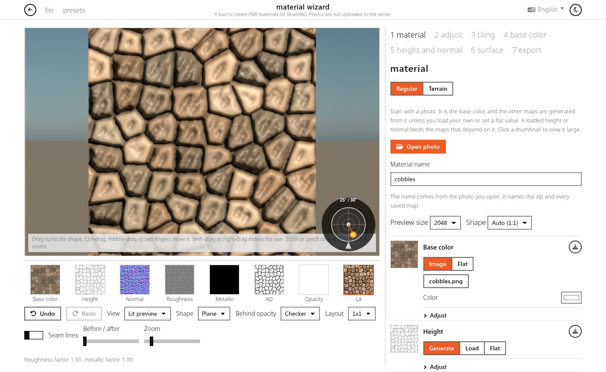
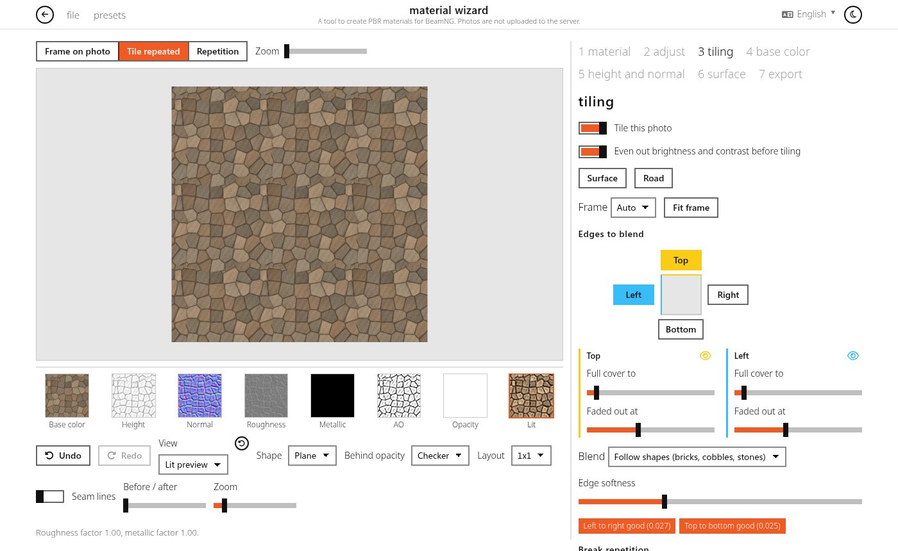
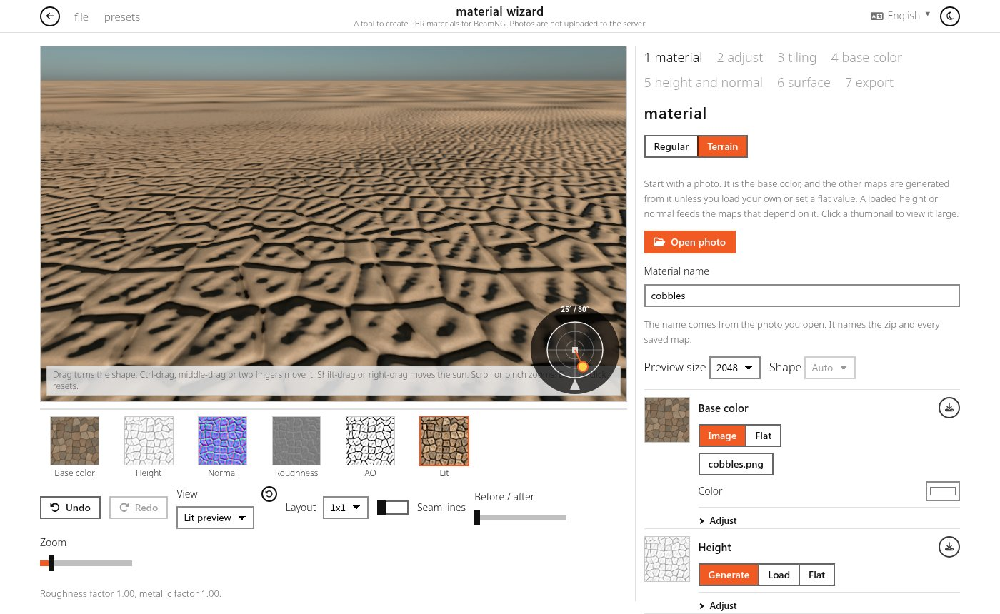
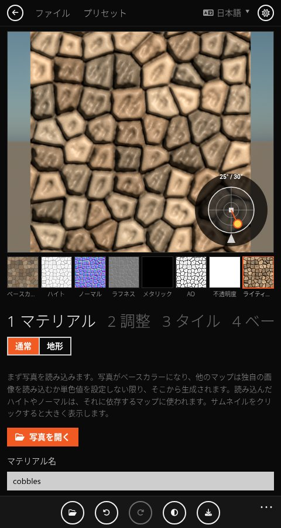

# Material Wizard

[](https://github.com/PrzemekWolw/material-wizard/actions/workflows/test.yml)
[](https://przemekwolw.github.io/material-wizard/)
[](https://przemekwolw.github.io/material-wizard/)
[](#languages)
[](LICENSE)

Material Wizard makes PBR materials for BeamNG.drive from one photo. It runs in the browser and nothing is uploaded.

| Lit preview | Tiling |
| :---: | :---: |
|  |  |
| **Terrain** | **Phone** |
|  |  |

## Maps

From the photo it builds base color, height, normal, roughness, metallic, AO and opacity.

- Each map can be generated, loaded from your own file, or set to a flat value.
- Base color can remove lighting: uneven brightness, cast shadows, highlights, and evening out by picked colors.
- Height and normal come from the photo's detail at several scales. Roughness also follows local contrast in the base color.
- Surface zones pick a material by color (for example moss on stone) with their own roughness, metallic and opacity.
- Every map has levels, contrast and a curve.

## Tiling

- Frame the repeating part of the photo, straighten it, fix perspective and crop.
- Edges are blended so the texture tiles, with optional evening of brightness across the tile.
- Per-axis seam scores, a repetition heatmap, and seamless texture bombing to break up visible repeats.
- Preview repeat layouts from 1x1 up to 3x3, with seam lines.

## Lit preview

The material is shown on a plane, sphere or cube under a sky with a movable sun. Shading, exposure, bloom and tonemapping follow the game's renderer, so the result looks close to what you get in BeamNG. Opacity is drawn as real transparency over the background or a checker.

## Terrain

Switch the material to Terrain on the first tab to make a TerrainMaterial instead.

- Detail and Macro are two layers of the same pipeline. Each keeps its own photo and settings. A layer without a photo is taken from the other one, so one photo still builds both.
- The tool writes detail and macro textures for base color, normal, roughness, AO and height.
- The preview shows the ground from a chosen height and angle, using the same distance fades and strengths as the game's terrain shader.
- Sizes, strengths, distances and the ground model are written to `main.materials.json`.

## Export and projects

- Export Maps saves a zip with the PNGs and `main.materials.json` (level, road and vehicle profiles; roads also get `textureLength.txt`). Output size can differ from the preview size, up to 8192.
- Single maps can be saved on their own, and the material JSON can be copied to the clipboard.
- A name prefix and numbering pattern cover batches of photos.
- Projects (`.mwz`) keep the photo, loaded maps and every setting, and open again exactly as they were saved.
- Presets save groups of settings and can be exported and imported.
- The page installs as an app, works offline, and opens `.mwz` files.

## Languages

English, Polish, Spanish, German, Italian, Chinese and Japanese. The first visit follows the browser language, and the choice in the top-right corner is saved. Texts live in `locales/<locale>/main.translation.json`, in the same flat layout as BeamNG's locale files.

## Running

No build step. Serve the repository as `/material-wizard/` under the [Car_Killer site](https://github.com/PrzemekWolw/przemekwolw.github.io), because the page uses that site's `../style.css`:

```bash
ln -sfn "$PWD" ../przemekwolw.github.io/material-wizard
cd ../przemekwolw.github.io && python3 -m http.server 8777
# open http://127.0.0.1:8777/material-wizard/
```

Tests:

```bash
npm ci
npm run check          # syntax check of every module
npm test               # Node tests: locales, export, tiling, terrain values, CSS and offline shell
npm run test:browser   # Playwright: golden images, projects, terrain, accessibility, phone layout, performance
```

GitHub Actions runs all three on Node 22 for every push and pull request.

`.nojekyll` stops GitHub Pages from running Jekyll on this repository.

## Project layout

| Path | Contents |
| --- | --- |
| `index.html`, `app.js` | Page and the entry point that starts every module |
| `src/engine/` | WebGL2 engine: render targets, map stages, lit and terrain preview, HDR |
| `src/shaders/` | GLSL shaders |
| `src/modules/` | UI features: view, tiling, slots, zones, terrain, export, projects, phone layout, tooltips |
| `src/services/` | State, undo, presets, translations, the background worker |
| `src/tile/` | Tiling on the CPU: seams, repeats, blending, light solve, bombing |
| `src/utils/` | Small shared helpers |
| `styles/` | Styles on top of the site's `style.css` |
| `locales/` | Translations |
| `test/` | Node and Playwright tests, golden images |

## License

GPL-3.0-or-later. See [LICENSE](LICENSE).
